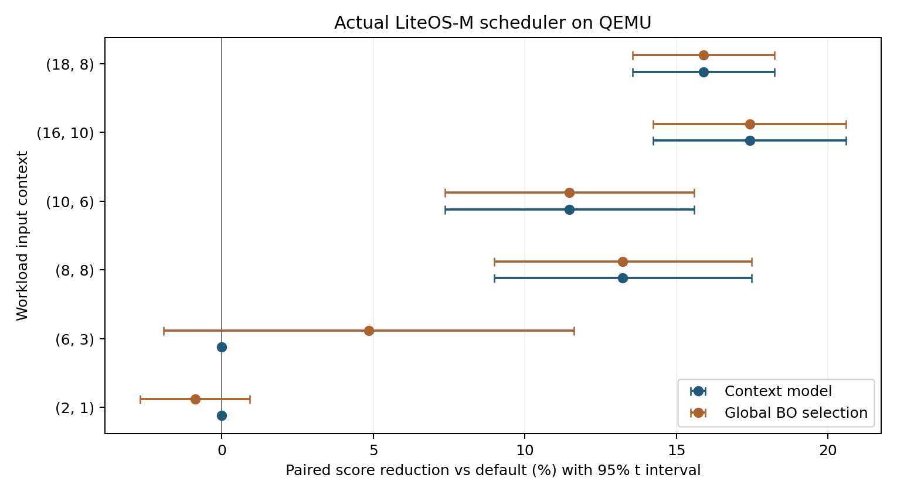

# OpenHarmony LiteOS-M 核心算法参数设置中期研究

**审计结论：具备大创中期工程成果的价值，可以公开复核；尚未证明 BO 优于随机搜索、单次闭环加速或真实设备性能提升。**

本项目围绕实际 OpenHarmony LiteOS-M 的同优先级任务调度器和 TLSF 内存分配器，完成参数控制、QEMU 测量、有限预算搜索、上下文决策树和 C++ 客体内核部署。公开版本形成于 **2026-10-27**，用于成员交接、中期答辩准备与研究复核。

## 成员从这里开始

1. [审计报告](docs/AUDIT.md)：算法是否合适、结果是否可信、哪些说法不能使用。
2. [答辩提纲与问答](docs/DEFENSE.md)：建议页序、可直接使用的讲述内容、证据位置。
3. [复现手册](docs/REPRODUCE.md)：只读核验、运行演示、完整重训的区别。
4. [结果与数据字典](docs/RESULTS.md)：指标、全部方法、统计范围和字段定义。
5. [后续成员任务](docs/NEXT_STEPS.md)：按研究优先级推进，无虚构历史分工。

## 已有可核查成果

| 内容 | 证据 |
|---|---|
| 两个实际内核算法，各两个控制参数 | `product/`、`evidence/kernel_research.patch` |
| 调度 18 种、内存 20 种候选配置 | `protocol.json` |
| 3144 条正式记录，其中 600 条测试 | `results/measurements.jsonl`、`results/test_results.json` |
| 原始串口与源码、镜像对应 | `evidence/*.gz`、`images/`、四份 `research/` 源码快照 |
| 128 组跨语言检查、60 组内核自动推荐闭环 | `results/model_consistency.json`、`results/closed_loop.json` |
| 本次独立复算及重新运行核验 | `audit/independent_checks.json`、`audit/runtime_checks.json` |

600 条测试是 **2 类算法 × 6 个上下文 × 10 个种子 × 5 种方法**，不是 600 个独立应用场景。每类上下文模型只有 30 个训练样本。正式采集耗时约 270 秒，不据此描述为持续数月的实验。

## 主要发现

- 调度上下文推荐在四个测试上下文的综合目标相对默认下降约 **11.47%～17.42%**。这是 `平均完成时间 + 0.5 × P95 首次响应` 的下降，不是吞吐量或端到端时间提升。
- 随机搜索和 BO 得到相同的全局参数，调度为 `(1000, 500)`，内存为 `(16, 32)`。当前结果没有证明 BO 的必要性或优势。
- 内存 `(4000,1)` 的综合目标改善约 **0.53%**，其他场景缺少稳定收益；三个 6000 操作测试上下文全部回退默认。
- 高压力内存负载的请求序列受分配成功与否影响。现有结果只描述这一自适应负载生成器的行为，**不能当作固定请求轨迹上的公平比较**。
- 预采样是一次完整运行。已有闭环中，预采样、推理和正式运行的内部 elapsed 合计为默认运行的约 **1.92～2.16 倍**。这仍未包含全部通信、清理等费用。



图中对比对象为默认参数；全局 BO 在本轮与随机搜索选择相同。全部五种方法见 [summary.csv](results/summary.csv)。

## 快速核验

在已安装依赖的 Ubuntu 22.04 环境：

```bash
python3 scripts/independent_audit.py
python3 scripts/recheck_runtime.py
```

第一个命令复算归档数据。第二个命令编译主机 C++ 检查程序、运行归档 ARM 镜像，把新实验放在 `audit/rerun/`，不覆盖原始研究数据。首次安装、从源码构建和重训见[复现手册](docs/REPRODUCE.md)。

## 公开范围

只公开技术代码、上游许可完整的必要源码、数据、压缩原始日志、镜像、图表及经过审计的 Markdown 交接资料。原申报表、联系方式、签名、经费底表、4 月申报 PPT/讲稿、旧 Python 仿真成果和本地 WSL 磁盘未纳入。六份原 Word 作为本地历史材料保留，公开解释以本仓库审计报告为准。

QEMU 运行的是实际内核代码，但 `icount` 不模拟真实芯片的周期精度；参见 [QEMU 官方说明](https://www.qemu.org/docs/master/devel/tcg-icount.html)。不宣称覆盖商业 HarmonyOS 手机系统、真实应用、物理功耗或生产安全。没有发表论文、软著获批或企业合作的新增证据。

第三方权利信息见 [THIRD_PARTY_NOTICES.md](THIRD_PARTY_NOTICES.md)。公开查阅不改变各文件原有许可，自编部分的再许可由项目权利人另行决定。
